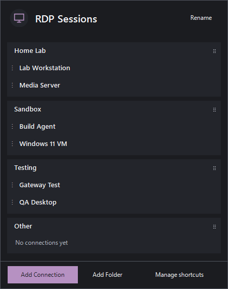
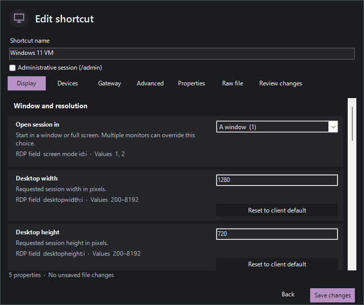

# RDP Sessions

**Your Remote Desktop shortcuts, one click from the Windows 11 taskbar.**

Older versions of Windows let you turn a folder of shortcuts into a taskbar toolbar. That was handy for Remote Desktop. Click the toolbar, pick a machine, and get back to work. The standard Windows 11 taskbar offers app pins and Jump Lists. RDP Sessions adds a grouped, editable menu for the .rdp files you already use. [Windows taskbar documentation](https://support.microsoft.com/en-us/windows/experience/personalization/customize-the-taskbar-in-windows)

| Browse grouped connections | Edit a shortcut |
| --- | --- |
|  |  |

## Install

1. Download the installer ZIP from [the latest release](../../releases/latest) and extract it.
2. Run **Install.cmd**. It installs for your Windows account and needs no administrator rights.
3. Find **RDP Sessions** in Start, right-click it, and choose **Pin to taskbar**.

The installer is unsigned. You can compare the ZIP with the release's SHA-256 checksum or build the executable from source.

## Use it

- Left-click the pin for the grouped launcher. Right-click for the Windows Jump List. Windows may limit the number of entries in its Jump List.
- Add a connection or copy existing .rdp files into the shortcut folder. Each immediate subfolder becomes a group. Files in the root appear under **Other**.
- Drag connections and groups to reorder them. Removed items go into the shortcut folder's archive.
- Right-click a connection to edit display, device, gateway, and advanced settings. **Properties** edits values. **Raw file** edits the full .rdp file. **Review changes** shows edits before saving. Signed files can be edited as unsigned copies.
- **Connect as administrator** requests an administrative session. The server and your account permissions determine the result.

## Privacy and limits

The launcher has no telemetry, update service, cloud sync, or credential store. It hands the selected file to Windows Remote Desktop Connection, which handles authentication and the session. Existing .rdp files can contain usernames, private hostnames, and authentication data. Keep them out of public repositories and open files from sources you trust.

The app targets Windows 11 with the built-in Remote Desktop Connection client. Windows and the remote host determine which settings apply. The launcher closes when you click away.

## Build from source

On 64-bit Windows 11, open PowerShell in the source folder. The build uses the Windows .NET Framework compiler, WinForms, and WPF, with no package downloads.

~~~powershell
.\Build.ps1 -Installer
~~~

The output is in the build folder. Use the **Install** switch to build and install directly. The default shortcut folder is **Remote Desktop Shortcuts** in Documents. Override it with **RDP_SESSIONS_HOME** or a local **shortcut-root.txt** beside the launcher.

To uninstall, exit the launcher, unpin it, and remove its Start shortcut and install folder from your local app data. The connection folder is separate.

## Contributing

Bug reports and small pull requests are welcome. Include your Windows version, steps to reproduce, and an example with fictional hostnames. See [SECURITY.md](SECURITY.md) to report a security issue privately.

Released under the [MIT License](LICENSE).
